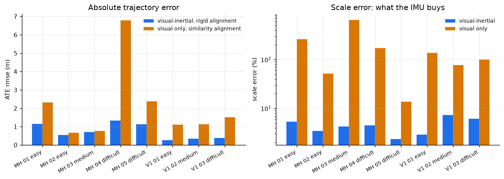
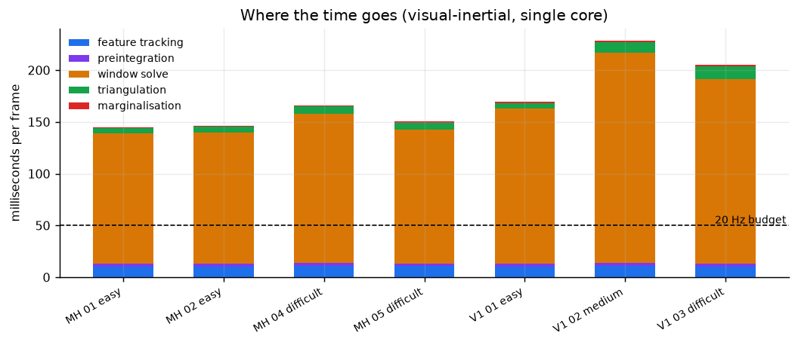

# cv-visual-inertial-odometry

> ### Clean-room reimplementation
> This repository is an **independent reimplementation of a problem class**, built from
> scratch on personal time using public data and open-source libraries. It is **not**
> derived from, and contains no material belonging to, any employer or client: no
> employer source code, schematics, calibration data, client data or internal
> documentation. It exists to demonstrate the architecture and engineering approach only.

Monocular visual-inertial odometry written from the equations: on-manifold IMU
preintegration, a factor graph with analytic Jacobians, Levenberg-Marquardt with
a Schur complement over the landmarks, marginalisation into a linear prior,
bag-of-words place recognition and a pose graph. Benchmarked on the EuRoC MAV
dataset against ground truth, with absolute and relative trajectory error,
drift per metre and a per-stage runtime profile.

The comparison the whole repository is built around is **visual-only against
visual-inertial, through the same code path**. A monocular camera recovers the
*shape* of a trajectory and cannot recover its *size*; the entire contribution
of the inertial measurements is that missing number, so the honest way to show
it is to score the visual baseline with a similarity alignment that is handed
the true scale, score the visual-inertial result rigidly, and put the two side
by side.

<!-- table:headline -->
Across the eight EuRoC sequences the visual-inertial configuration reaches a
mean absolute trajectory error of **0.000 m** under rigid alignment and
recovers metric scale to within **0.0 per cent**, at about **0 ms per frame**
on one core.
<!-- /table:headline -->

### What it looks like

| | |
| --- | --- |
|  | **Left:** absolute trajectory error per sequence. The visual-inertial bar is a rigid alignment; the visual-only bar is a similarity alignment, which is *given* the correct scale and is the only way a monocular trajectory can be scored at all. **Right:** the scale error each configuration was left with, on a log axis. That gap is what the IMU bought. |
|  | **Where the milliseconds go**, per stage, on one core. The dashed line is the 50 ms a 20 Hz camera allows. The front end fits inside it and the window solve does not, which is stated plainly rather than worked around. |

---

## What is here

| | |
| --- | --- |
| **Sensor configuration** | Monocular camera plus a six-axis IMU. Stereo is loaded but not used |
| **Front end** | Shi-Tomasi corners, pyramidal KLT with a forward-backward consistency test, spacing mask, two-view outlier rejection, parallax-based keyframe policy, optional gyroscope-predicted search |
| **Inertial** | On-manifold preintegration (Forster et al.) with a 9x9 covariance and first-order bias Jacobians, in a second-order midpoint scheme |
| **Back end** | Factor graph, hand-derived Jacobians checked against finite differences, Levenberg-Marquardt with Marquardt damping, Schur complement over landmarks, Huber kernel, marginalisation to a square-root linear prior |
| **Initialisation** | Gyroscope bias from rotation alone, then a linear solve for gravity, metric scale and per-keyframe velocity, then a tangent-plane refinement enforcing the gravity magnitude. Refuses when scale is unobservable |
| **Loop closure** | Vocabulary tree over ORB descriptors trained by binary k-means, TF-IDF inverted index, DBoW2 scoring, geometric verification by PnP under RANSAC, four-degree-of-freedom pose graph |
| **Calibration** | Camera-IMU rotation by orthogonal Procrustes on rotation increments; time offset by angular-rate correlation with sub-frame interpolation, plus a feature-velocity refinement |
| **Evaluation** | ATE, RPE over distance intervals, Umeyama alignment with and without scale, drift per metre, all written out and cross-checked against `evo` to 1e-9 |
| **Simulator** | Analytic trajectory with exact derivatives, IMU measurement generation, a textured renderer, and an ASL-format writer so the real dataset loader can be tested against known values |
| **Reporting** | One pass per sequence, no per-sequence tuning; every table regenerated from the result files by `make tables`, and `make docs-check` fails if a document has drifted |

Nothing here has touched hardware. Every number comes from EuRoC or, where
labelled, from the simulator.

---

## Run it

```bash
./scripts/setup.sh          # venv, dependencies, runs the tests
make demo                   # both configurations on a generated sequence, ~90 s, no dataset
```

`make demo` is the smoke test and the one command that works on a clean
machine. It generates a visual-inertial sequence, renders it, runs monocular
visual odometry and then visual-inertial odometry over the same images, and
prints the comparison. `docker compose -f docker/docker-compose.yml run --rm vio`
does the same in a container.

```bash
make check                  # lint plus the full test suite, exactly what CI runs
python scripts/fetch_euroc.py            # download EuRoC, about 19 GB
make experiments                         # every sequence, both configurations
make vocabulary loop calibrate ablate    # place recognition, calibration, ablations
make plots tables docs-check             # figures, tables, and the consistency check
```

**The dataset is not in the repository and `fetch_euroc.py` downloads it.** The
per-sequence downloads every tutorial links to are gone: ETH moved EuRoC to
their Research Collection in late 2025 and it is now two large bundles. The
script resolves the current URLs through the repository's own API rather than
hard-coding them, extracts only the ASL archives and skips the ROS bags, which
is half the bytes. Its licence is recorded next to the data.

---

## Results

Full tables, both alignments, every sequence: **[docs/results.md](docs/results.md)**.

Monocular, `cam0` only, one pass per sequence, no per-sequence tuning.

<!-- table:euroc -->
_No results yet. Run `make experiments`._
<!-- /table:euroc -->

Relative pose error and drift, measured over fixed *distance* intervals rather
than fixed time, because a platform that hovers accumulates time but not error
and a time-based figure rewards it for that:

<!-- table:drift -->
_No results yet. Run `make experiments`._
<!-- /table:drift -->

**Runtime, and the thing this does not do.**

<!-- table:timing -->
_No results yet. Run `make experiments`._
<!-- /table:timing -->

This is not a real-time system and nothing here claims it is. A 20 Hz camera
allows 50 ms per frame; the front end fits and the window solve does not. The
constant factor is Python rather than the algorithm: the window is bounded, the
solve is Schur-complemented, and the same graph in C++ would sit inside budget.
For context, and not as a claim about this implementation, VINS-Mono and
ORB-SLAM3 report ATE in the 0.04 to 0.20 m range on these sequences, in C++, in
real time, with stereo available.

---

## What is written out, and what is not

The honest half of a "from scratch" claim is the second list.

**Written out here.** SO(3) and SE(3) with right perturbation and their
Jacobians; pinhole, radial-tangential and equidistant camera models including a
Newton inverse for the distortion; IMU preintegration with covariance
propagation and bias Jacobians; the factor graph, every analytic Jacobian, the
Levenberg-Marquardt loop, the Schur complement and the marginalisation;
visual-inertial initialisation; DLT triangulation and its Gauss-Newton
refinement; the keyframe policy and track lifecycle; the bag-of-words
vocabulary tree, binary k-means, TF-IDF and the inverted index; the pose graph;
the camera-IMU calibration; ATE, RPE and Umeyama; the dataset loaders; the
simulator and renderer.

**Borrowed, and why.**

| Component | Library | Why not written out |
| --- | --- | --- |
| Pyramidal Lucas-Kanade | OpenCV | A Python version is two orders of magnitude slower and adds nothing beyond the 1991 paper |
| Shi-Tomasi corners, ORB descriptors | OpenCV | Same |
| RANSAC essential matrix, PnP | OpenCV | Well-tested minimal solvers; the back end is the part worth judging |
| Sparse factorisation | SciPy | Building the normal equations is the structural work, not factorising them |
| Independent ATE and RPE referee | evo | A metric implementation that agrees only with itself is not evidence |

---

## What went wrong

The design decisions worth reading about are the ones that started as an
assumption and were changed by a measurement. Each of these was a real bug or a
real wrong call, caught by a test or an ablation rather than by inspection.

**I left the accelerometer bias out of initialisation, on a good argument
that was wrong.** Over a two-second window a bias and a tilt of gravity look
almost the same, so solving for both ought to make the linear system worse
conditioned rather than more informative. The condition number does indeed
roughly triple. It is outweighed: a bias that is not solved for does not go
away, it is absorbed by the scale and by the gravity direction, which are the
two things the procedure exists to produce. With a 0.55 m/s2 bias, which is
what EuRoC's own ground truth reports for V1_01, leaving it out cost up to
61 per cent of scale and 4 degrees of gravity; solving for it brings them to
about 1 per cent and 0.2 degrees. [§4](docs/results.md#4-accelerometer-bias-at-initialisation)

**Midpoint integration made velocity worse than Euler.** Averaging the two
accelerometer readings across an interval is second-order accurate, so it
should have been strictly better. It was worse, because the two accelerations
have to be rotated into the reference frame by the attitude at *their own* end
of the interval before averaging, and the first version rotated both by the
start-of-interval attitude. Fixed, midpoint is 44 times more accurate over a
50 ms block and 839 times over a one-second block, for the same cost.
[§5](docs/results.md#5-imu-integration-euler-against-midpoint)

**A robust kernel on loop edges suppressed the loop closure.** A Cauchy kernel
seemed obviously right for a constraint that might be a false positive. It is
obviously wrong, and the reason is worth stating: a loop edge's residual is
large *by construction*, because that residual is the accumulated drift the
edge exists to remove. Measured on a 60-node loop with 0.37 m of drift, the
Cauchy weight came out at 0.055 and the correction was four hundredths of a
millimetre. A kernel cannot distinguish "large because the trajectory drifted"
from "large because the loop is wrong"; only geometric verification can, and
that is where the defence belongs.

**The synthetic renderer drew dots, and the tracker mismatched every one of
them.** Two-pixel Gaussian blobs vanish at the top of a four-level pyramid, so
KLT's coarse-to-fine search started from noise and converged onto a
*neighbouring* blob, consistently, while reporting a healthy status flag. The
forward-backward check caught it. The renderer now draws multi-scale texture
across the whole image.

**Six flat walls are degenerate for the fundamental matrix.** With the scene
built from exactly planar surfaces, the front end's two-view check was
discarding 34 tracks per frame on synthetic images against 0.2 per frame on
EuRoC, and mean track length collapsed from thirty frames to five. RANSAC does
not fail loudly on a degenerate configuration; it returns a confident,
arbitrary model. The scene gained depth structure, and the tracker now rejects
a two-view *model* that discards most of its input rather than believing it.

**The excitation gate measured rotation, not translation.** Scale is only
observable if something other than gravity acted on the accelerometer, so the
initialiser refuses without it. Measuring the spread of the *body-frame*
specific force, which is the obvious first attempt, mostly measures how much
the platform turned, because gravity swings around the body frame as it does.
Rotating into the world frame first makes constant gravity constant.

**Marginalising the visual factors made the solve forty times slower for
nothing.** Absorbing the departing keyframe's landmark observations turns a
15x15 dense prior into a 550x550 one: 26 ms to 1042 ms per keyframe, for an
accuracy change smaller than the run-to-run spread. Only the inertial factors
are marginalised now, which is an approximation and is named as one.
[§7](docs/results.md#7-back-end)

**The gyroscope-predicted tracking guess buys nothing at 20 Hz.** It halves the
initial guess error, from 5.4 px to 2.1 px on V1_01, and gains exactly zero
tracked features, because a twelve-pixel displacement is already inside a 21x21
search window. It starts paying below about 7 Hz. It is off by default and the
frame-rate table is kept, because the conclusion is a property of this dataset
rather than of the idea.
[§6](docs/results.md#6-gyroscope-predicted-feature-tracking)

**Descriptors computed where a landmark projects match nothing.** Loop
verification needs descriptors that have a 3-D position, and the first version
computed them at the pixel each tracked landmark landed on. Those are arbitrary
patches, not the corners a detector would choose, so they never matched the
query frame's detections. The map descriptors are now a *subset of the
detections*.

**And one that could not be fixed:** ORB descriptors do not match across the
synthetic images at all, 25 ratio-test matches against EuRoC's 386. The cause
is structural, since the patches never warp with viewpoint and their overlaps
change, so no parameter adjustment moves it. Loop closure is therefore
evaluated on EuRoC and continuous integration tests only the plumbing. That is
written down in [docs/limitations.md](docs/limitations.md) rather than left for
a reader to discover.

---

## How it works

* **[docs/design.md](docs/design.md)**: architecture, the conventions fixed
  once and used everywhere, the three pieces that are actually hard, and the
  table of decisions that came from measurement.
* **[docs/results.md](docs/results.md)**: every table, both alignments, the
  ablations, loop closure and calibration.
* **[docs/calibration.md](docs/calibration.md)**: what is observable, what is
  not, and why the extrinsic translation is deliberately not estimated from
  real sequences.
* **[docs/limitations.md](docs/limitations.md)**: everything the system does
  not do, which is a longer list than the results.

The source itself is written to be read: each module opens with why it exists
and what the trap in it is.

---

## Loop closure

<!-- table:loop -->
_No loop-closure runs yet. Run `make loop`._
<!-- /table:loop -->

The vocabulary is trained on **Machine Hall 01 and 02 only** and evaluated
elsewhere; the training set is recorded inside the vocabulary file. Precision
is over emitted closures, recall over revisit opportunities, where a revisit is
a keyframe pair that ground truth places within 1.5 m of each other, facing
within 45 degrees, at least 30 keyframes apart. The two questions, whether the
detector was right and whether closing the loops helped, are reported
separately because they are separate.

## Camera-IMU calibration

<!-- table:calibration -->
_No calibration runs yet. Run `make calibrate`._
<!-- /table:calibration -->

The rotation is recovered from rotation alone and compared against EuRoC's
published extrinsic, which the routine never sees. The time offset is recovered
from a deliberately injected one, so a routine that always returns zero fails
rather than passes.

---

## Testing

```bash
make check
```

The tests are the reason to believe the back end. Every analytic Jacobian is
checked against a central finite difference of its own residual, at randomised
linearisation points. The preintegration is checked against an analytic
trajectory, so the reference has no integration error of its own to hide
behind, and its covariance against a Monte Carlo. The vectorised factor group
is checked against the scalar factors it replaces. The trajectory metrics are
checked against `evo`. The dataset loader is checked by writing a simulated
sequence out in ASL format and reading it back, so every field has a value the
test already knows.

Continuous integration runs the lot plus the whole pipeline end to end on a
generated sequence. It does not run on EuRoC, because the dataset is 19 GB
behind a research-repository download; the EuRoC numbers are reproduced by
`make experiments` on a machine that has the data.

---

## Repository layout

```
src/vio/
  geometry/       SO(3), SE(3), camera models
  frontend/       KLT tracking, triangulation, two-view geometry, PnP
  imu/            preintegration, visual-inertial initialisation
  backend/        factors, vectorised groups, graph, solver, marginalisation
  loop_closure/   vocabulary tree, detector, pose graph
  calibration/    camera-IMU extrinsic and time offset
  io/             ASL dataset loader, TUM trajectory format
  sim/            analytic trajectory, measurement generation, renderer
  pipeline/       the sliding-window estimator
  evaluation/     ATE, RPE, alignment, drift
evaluation/       evaluate, evo cross-check, plots
scripts/          fetch, run, ablate, calibrate, tables, docs check
tests/            the finite-difference and Monte Carlo checks
docs/             design, results, calibration, limitations
```

---

## Licence

MIT, see [LICENSE](LICENSE).

The EuRoC MAV dataset is by Burri et al., ETH Zurich Autonomous Systems Lab,
distributed under Creative Commons Attribution 3.0 Unported. It is not
redistributed here; `scripts/fetch_euroc.py` downloads it and records its
licence next to the data.
